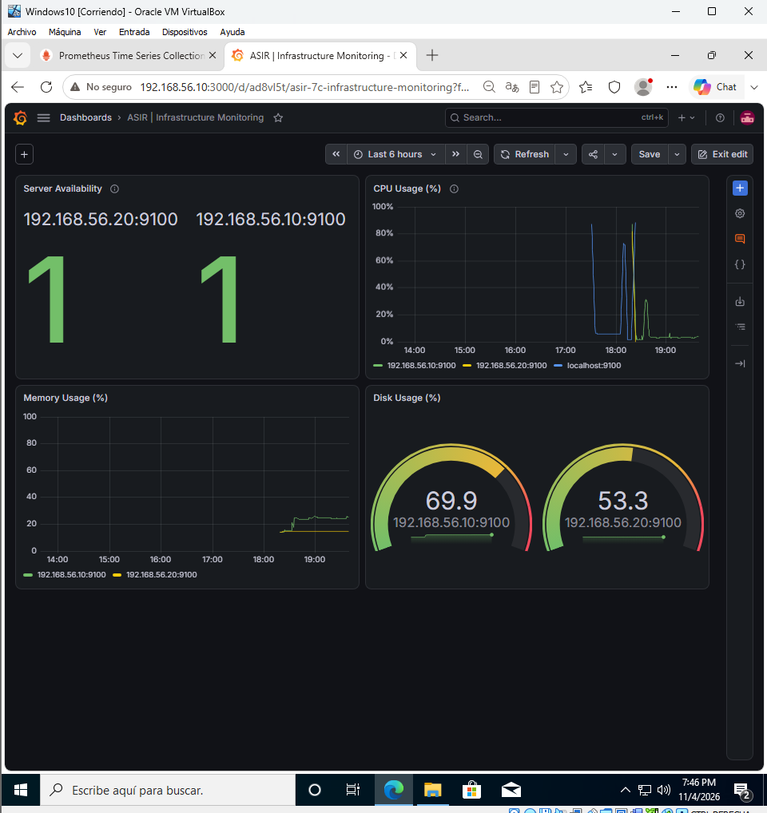
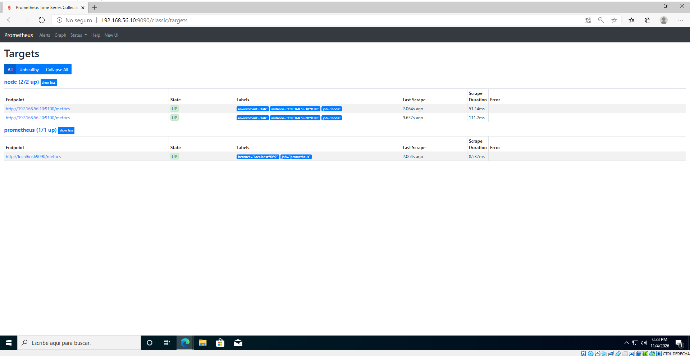
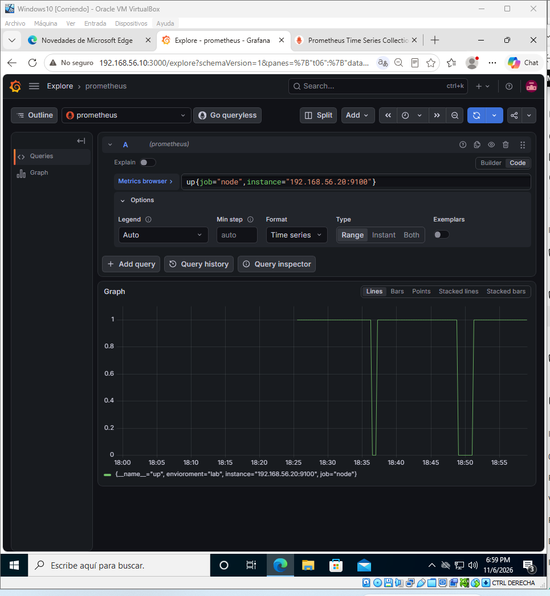

# Infra Monitoring Lab

Laboratorio práctico de **monitorización Linux con Ubuntu Server, Prometheus, Node Exporter y Grafana**, realizado para un portfolio técnico de ASIR.

## Empieza aquí: guía completa con capturas

### **[Leer la guía paso a paso de principio a fin](docs/GUIA-PASO-A-PASO.md)**

La guía es **un solo documento**, no un índice de diez ficheros. Reúne la arquitectura, creación de las VMs, configuración de red, instalación, comandos explicados, capturas colocadas en cada paso, gráficas de Grafana, pruebas reales y troubleshooting.

## Arquitectura del laboratorio

| Equipo | IP interna | Función |
|---|---|---|
| `monitor01` | `192.168.56.10` | Prometheus + Grafana + Node Exporter |
| `servidor01` | `192.168.56.20` | Node Exporter y pruebas de carga |
| Windows10 | `192.168.56.100` | Cliente de administración web |

Red interna de VirtualBox: `asir-monitoring` (192.168.56.0/24).

## Evidencias principales

**Dos agentes monitorizados y Prometheus UP:**

**Detección de caída y recuperación del exporter:**

## Archivos técnicos

- [Guía completa con capturas](docs/GUIA-PASO-A-PASO.md)
- [Consultas PromQL](queries/consultas-promql.md)
- [Configuración de Prometheus (ejemplo)](configs/prometheus/prometheus.example.yml): pendiente de sustituir o complementar con la exportación real final.
- Dashboard de Grafana en JSON: **pendiente de exportación** desde la VM, no se presenta como existente.

> Proyecto educativo en máquinas virtuales aisladas. HTTP sin endurecimiento: **no exponer el laboratorio directamente a Internet**.