# Infra Monitoring Lab — Guía completa de implementación

> **Un único recorrido técnico, de principio a fin**, realizado en un laboratorio aislado de VirtualBox para el portfolio de ASIR. Cada fase explica qué se hizo, por qué, cómo se verificó y muestra las capturas originales donde corresponde.

**Ruta rápida:** [Inicio y objetivos](#1-objetivos-y-arquitectura) · [Red](#3-configuracion-de-red) · [Node Exporter](#5-node-exporter) · [Prometheus](#6-prometheus) · [Grafana](#9-grafana-y-dashboard) · [Pruebas](#10-pruebas-reales-de-monitorizacion) · [Incidencias](#11-incidencias-y-soluciones) · [Reproducción](#12-conclusiones-y-como-reproducirlo)

**Cómo leer esta guía:** los comandos son de las máquinas virtuales, no del anfitrión. Los fragmentos marcados como *ejemplo reproducible* son una reconstrucción instructiva, no una copia certificada del archivo de producción. Las capturas corresponden a etapas distintas: por eso algunas muestran la configuración inicial y otras la final.

---

## 1. Objetivos y arquitectura

El objetivo fue montar un sistema de monitorización capaz de observar **CPU, RAM, disco y disponibilidad** de dos servidores Ubuntu. Node Exporter publica las métricas; Prometheus las consulta y almacena; Grafana las representa. Una VM Windows se utiliza exclusivamente como cliente de administración web.

| Máquina | Dirección interna | Rol | Puertos relevantes |
|---|---|---|---|
| `monitor01` | `192.168.56.10/24` | Prometheus, Grafana y Node Exporter | 9090, 3000, 9100 |
| `servidor01` | `192.168.56.20/24` | Nodo monitorizado mediante Node Exporter | 9100 |
| Windows 10 (cliente) | `192.168.56.100/24` | Navegador y administración | Conexiones salientes HTTP |

```text
                 Windows 10 (cliente)
                   192.168.56.100
                       |
         Red interna: asir-monitoring
                       |
        +--------------+---------------+
        |                              |
 monitor01 .10                    servidor01 .20
 Prometheus :9090                 Node Exporter :9100
 Grafana :3000                         ^
 Node Exporter :9100                   |
        +---------- scrape -----------+
```

**Por qué esta arquitectura:** separamos la recopilación de métricas (Prometheus), su exposición (Node Exporter) y su visualización (Grafana). La red interna aisla el tráfico del laboratorio; adaptadores NAT adicionales se utilizaron para tareas como las actualizaciones o la sincronización horaria. El acceso HTTP no está endurecido para exposición pública.

## 2. Creación de las máquinas virtuales

Se prepararon las máquinas en Oracle VM VirtualBox, agrupadas bajo `infra-monitoring-lab`. Las dos Ubuntu se configuraron con **Ubuntu Server 26.04.1 LTS**, confirmado posteriormente con `/etc/os-release`. Antes de la instalación de servicios se definieron nombres descriptivos para distinguir las funciones de cada VM.

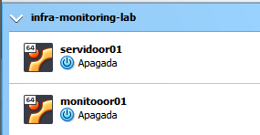

*Figura — Máquinas Ubuntu agrupadas en VirtualBox.*

Para conectar las máquinas se habilitó un adaptador en **Red interna**, con nombre idéntico `asir-monitoring` en todas las VMs participantes. Es importante que el nombre coincida exactamente: si se utilizan redes internas distintas, las máquinas no comparten el mismo segmento virtual.

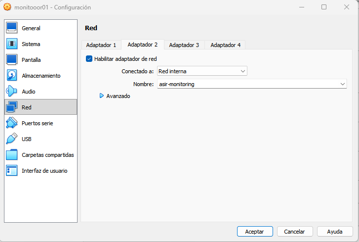

*Figura — Adaptador interno de monitor01 en asir-monitoring.*

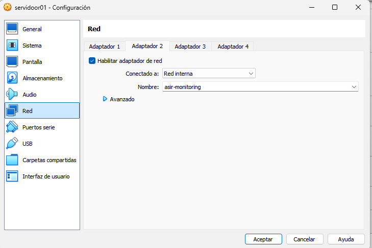

*Figura — Adaptador interno de servidor01 en asir-monitoring.*

**Verificación del paso:** cada VM debe tener un adaptador activo en la red interna. Se emplearon adaptadores adicionales para Internet cuando fueron necesarios, sin usar el modo puente para publicar el laboratorio en la LAN real.

---

## 3. Configuración de red

El adaptador interno de Ubuntu se identificó como `enp0s8`. El otro adaptador, `enp0s3`, se utilizó para NAT. Primero se inspeccionó la configuración existente y, después, se establecieron las IP internas estáticas.

```bash
ip a
ls -l /etc/netplan/
sudo cat /etc/netplan/*.yaml
```

`ip a` permite identificar las interfaces e IP presentes. Netplan guarda la definición persistente de red en ficheros YAML dentro de `/etc/netplan`. La captura inicial muestra el adaptador NAT con DHCP antes de añadir las IP internas.

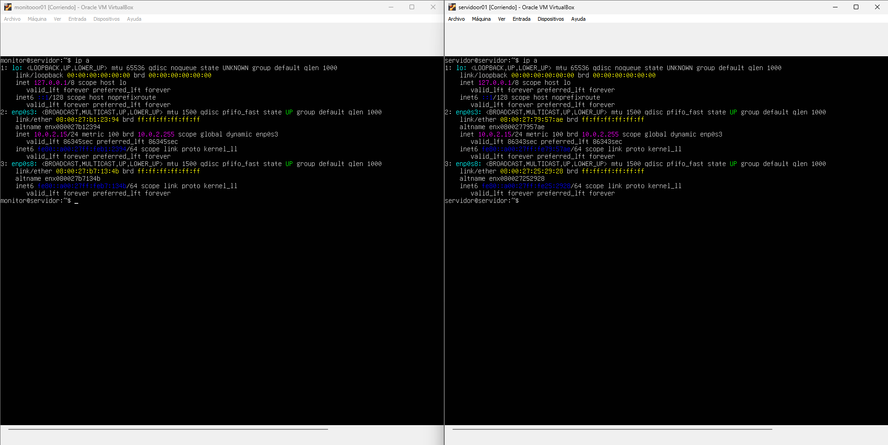

*Figura — Interfaces identificadas en ambas máquinas Ubuntu.*

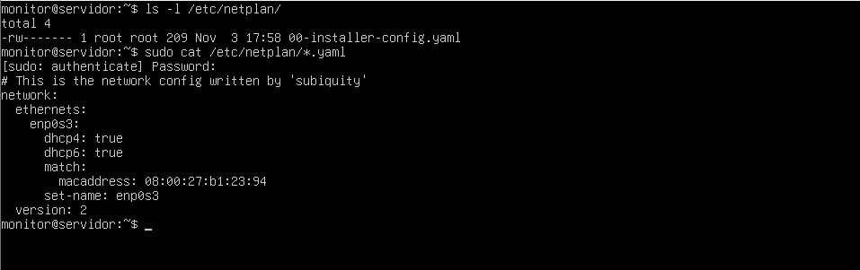

*Figura — Configuración inicial de Netplan antes de la IP estática.*

En una instalación reproducible, el bloque para la interfaz interna puede tener esta forma (debe adaptarse e integrarse en el YAML real, sin eliminar la configuración NAT existente):

**Ejemplo de `monitor01`:**

```yaml
network:
  version: 2
  ethernets:
    enp0s8:
      dhcp4: false
      addresses: [192.168.56.10/24]
```

**Ejemplo de `servidor01`:** cambiar la dirección a `192.168.56.20/24`. No se configura una puerta de enlace en la interfaz interna: el acceso a Internet, cuando existe, sale por NAT.

Al editar Netplan se puede validar y aplicar con:

```bash
sudo netplan generate
sudo netplan try
# Si todo es correcto, confirmar los cambios en la sesión interactiva.
```

> **Precaución:** `netplan try` puede alterar la conectividad de la VM. Conviene ejecutarlo desde la consola de VirtualBox y conservar copia del YAML anterior. Las capturas siguientes prueban las direcciones finales, no son una exportación literal de los archivos Netplan.

Se comprobó el estado real de cada interfaz:

```bash
ip -4 addr show enp0s8
```

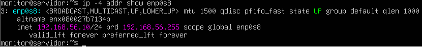

*Figura — Dirección estática 192.168.56.10/24 de monitor01.*

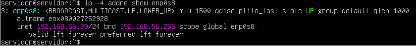

*Figura — Dirección estática 192.168.56.20/24 de servidor01.*

Finalmente comprobamos la comunicación en ambos sentidos:

```bash
# Desde monitor01
ping -c 4 192.168.56.20

# Desde servidor01
ping -c 4 192.168.56.10
```

Los resultados mostraron **4 paquetes recibidos de 4 enviados y 0 % de pérdida**. `ping` demuestra conectividad ICMP, pero no garantiza que un puerto de servicio esté abierto; ese paso se verificó después con HTTP.

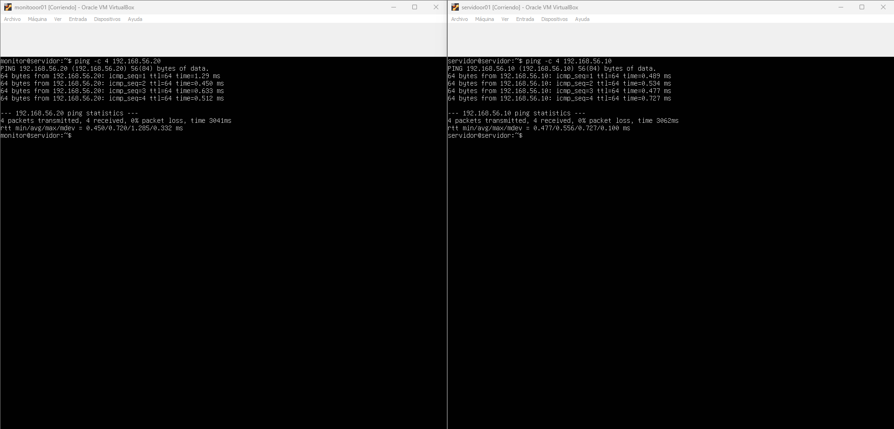

*Figura — Conectividad ICMP bidireccional sin pérdida de paquetes.*

---

## 4. Preparación del sistema Ubuntu

Antes de añadir servicios, se comprobó la versión de Ubuntu y se actualizaron los índices de paquetes. La separación entre `apt update` (consulta los índices) y `apt upgrade` (actualiza paquetes instalados) permite entender qué cambia realmente en el sistema.

```bash
cat /etc/os-release
sudo apt update
apt list --upgradable
# Se aplicaron actualizaciones de paquetes durante la práctica.
```

La salida confirmó **Ubuntu 26.04.1 LTS**. Durante la actualización hubo servicios que pospusieron su reinicio y se decidió no reiniciar inmediatamente las VMs; esto se dejó registrado como una limitación de ese momento, no como recomendación general.

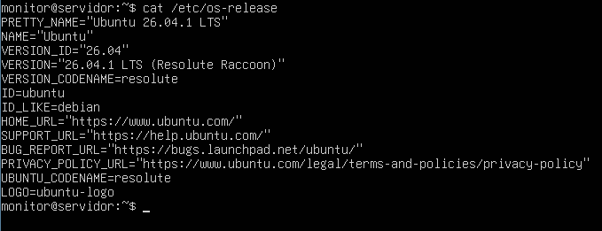

*Figura — Versión Ubuntu 26.04.1 LTS en monitor01.*

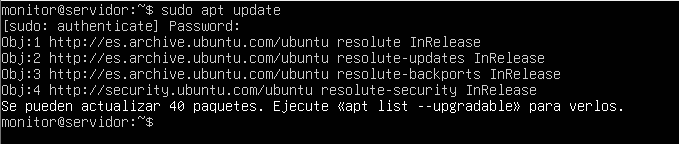

*Figura — Actualización del índice de paquetes mediante APT.*

**Criterio de validación:** repositorios accesibles y sistema identificado. Un entorno de monitorización necesita también relojes coherentes; durante la práctica la sincronización horaria generó incidencias que se documentan en el apartado 11.

---

## 5. Node Exporter

Node Exporter es el agente que expone métricas del sistema en formato Prometheus. Se instaló primero en `monitor01` para probarlo de manera local y más tarde en `servidor01` para habilitar la monitorización remota.

```bash
sudo apt install prometheus-node-exporter
sudo systemctl status prometheus-node-exporter
sudo ss -lntp | grep 9100
```

`systemctl status` muestra si el servicio está activo y habilitado; `ss` confirma que existe un proceso escuchando en el puerto TCP **9100**.

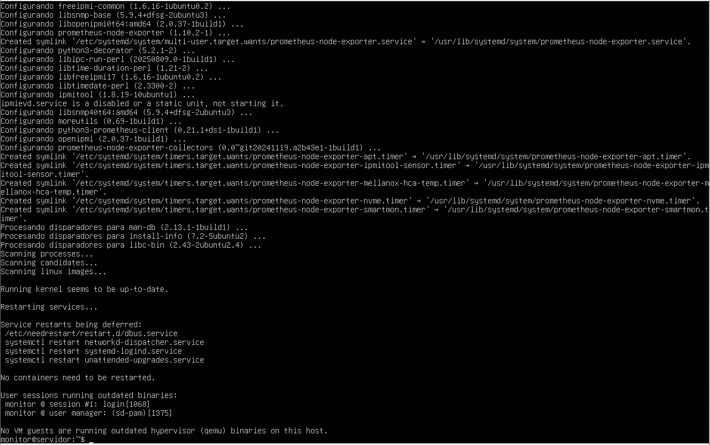

*Figura — Instalación del paquete de Node Exporter.*

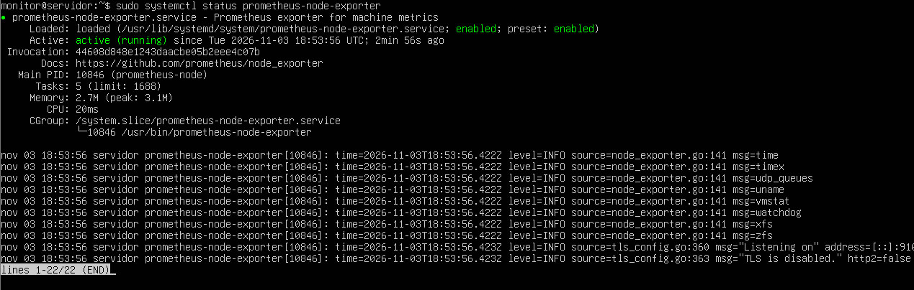

*Figura — Servicio Node Exporter activo y habilitado.*

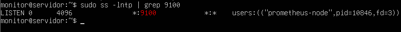

*Figura — Node Exporter escuchando en TCP 9100.*

Para probar la salida HTTP y no solamente el estado del proceso:

```bash
curl -s http://localhost:9100/metrics | head -n 20
curl -s http://localhost:9100/metrics | grep '^node_memory_MemAvailable_bytes '
curl -s http://localhost:9100/metrics | grep -E '^node_memory_(MemTotal|MemAvailable)_bytes '
```

Las líneas `# HELP` describen la métrica, las `# TYPE` indican su tipo y las demás contienen valores. La memoria se expresa en **bytes**, que se convierten en porcentajes mediante consultas PromQL.

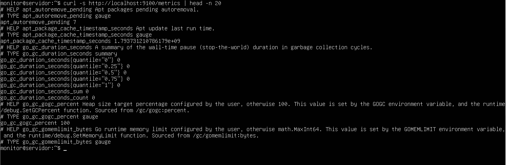

*Figura — Primeras métricas publicadas en /metrics.*

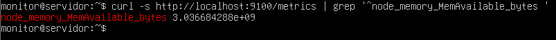

*Figura — Métrica de memoria disponible.*

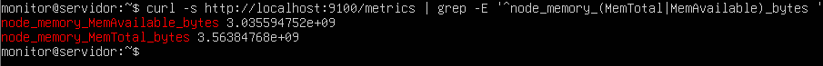

*Figura — Comparación de memoria total y disponible.*

Se repitió la instalación de Node Exporter en `servidor01` y, desde `monitor01`, se realizó una consulta HTTP contra el otro servidor:

```bash
curl --connect-timeout 5 -sS http://192.168.56.20:9100/metrics | grep '^node_memory_MemTotal_bytes '
```

**Por qué es importante:** demuestra que `monitor01` puede consumir métricas por la red interna, no solo hacer ping a `servidor01`.

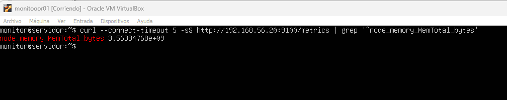

*Figura — Consulta remota de métricas de servidor01 desde monitor01.*

---

## 6. Prometheus

Prometheus recopila periódicamente métricas HTTP y almacena series temporales. En este laboratorio se instaló únicamente en `monitor01`.

```bash
apt policy prometheus
sudo apt install prometheus
sudo systemctl status prometheus
sudo ss -lntp | grep 9090
curl -s http://localhost:9090/-/ready
```

El servicio quedó **active (running)**, escuchando en el puerto **9090**; la comprobación `/-/ready` devolvió `Prometheus Server is Ready.`

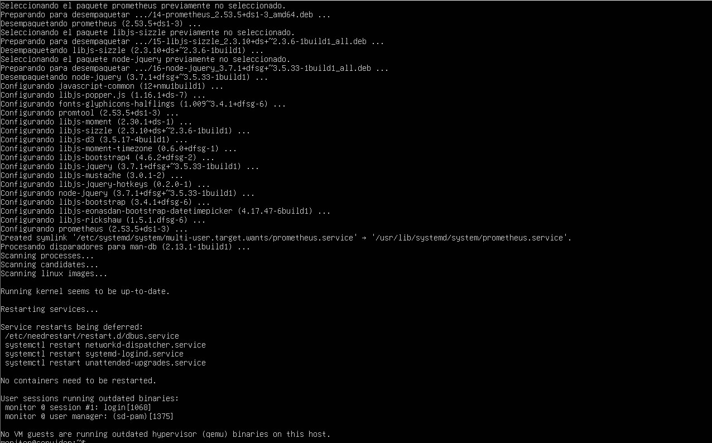

*Figura — Instalación del paquete Prometheus.*

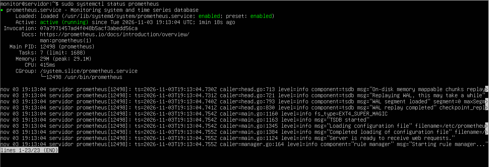

*Figura — Prometheus activo como servicio de systemd.*

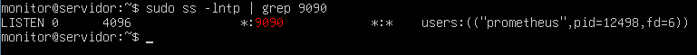

*Figura — Puerto TCP 9090 en escucha.*

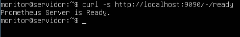

*Figura — Endpoint de salud de Prometheus preparado.*

La primera configuración de `/etc/prometheus/prometheus.yml` contenía el target propio `localhost:9090` y el agente local `localhost:9100`. Se inspeccionó antes de editar:

```bash
sudo cat /etc/prometheus/prometheus.yml
```

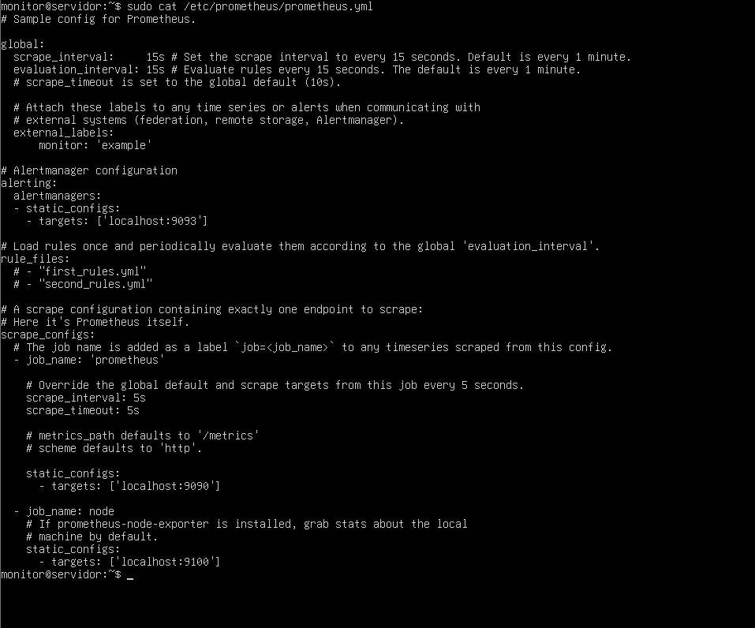

*Figura — Configuración inicial de Prometheus antes de añadir la segunda VM.*

Luego se aprendió a consultar la API HTTP de Prometheus, primero con `up` (resultado `1` si el último scrape funcionó) y después con una métrica de RAM:

```bash
curl -s 'http://localhost:9090/api/v1/query?query=up' | python3 -m json.tool
curl -sG --data-urlencode 'query=node_memory_MemAvailable_bytes' 'http://localhost:9090/api/v1/query' | python3 -m json.tool
```

Estas consultas no configuran ni modifican Prometheus: solo leen métricas.

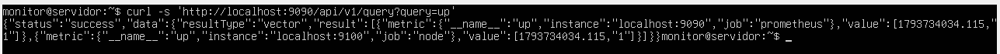

*Figura — Consulta de disponibilidad a la API Prometheus.*

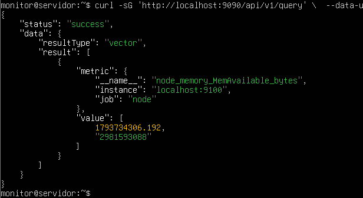

*Figura — Consulta de RAM disponible a la API Prometheus.*

---

## 7. Prometheus multiservidor

Una vez verificado el acceso a `192.168.56.20:9100`, se añadió el segundo Node Exporter. Se usó una copia de seguridad del YAML, comprobación con `promtool` y reinicio del servicio:

```bash
sudo cp /etc/prometheus/prometheus.yml /etc/prometheus/prometheus.yml.bak
sudo nano /etc/prometheus/prometheus.yml
promtool check config /etc/prometheus/prometheus.yml
sudo systemctl restart prometheus
systemctl is-active prometheus
```

El siguiente fragmento muestra **la parte relevante reconstruida de la configuración final** (no una exportación del YAML completo):

```yaml
scrape_configs:
  - job_name: 'prometheus'
    static_configs:
      - targets: ['localhost:9090']

  - job_name: 'node'
    static_configs:
      - targets:
          - '192.168.56.10:9100'
          - '192.168.56.20:9100'
        labels:
          environment: 'lab'
```

Windows tenía la IP `192.168.56.100`, pero **no era un target** porque se utilizaba como cliente web. La interfaz clásica del paquete de Prometheus estaba disponible en `http://192.168.56.10:9090/classic/targets`.

La validación visual mostró tres targets en estado **UP**: Prometheus y los dos agentes Node Exporter.

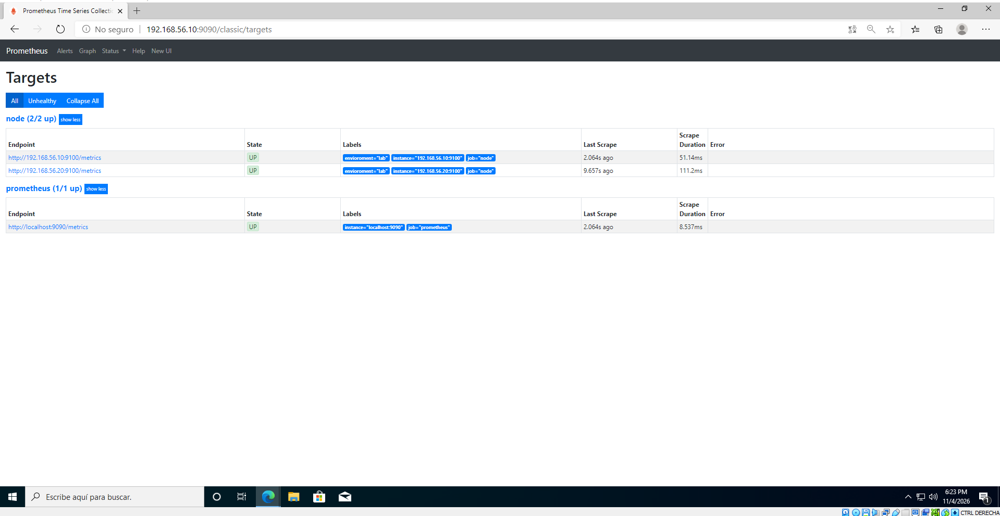

*Figura — Tres targets UP: Prometheus y dos Node Exporter.*

### Primeras consultas y gráficas en Prometheus

Las métricas originales se verificaron en la interfaz clásica mediante expresiones PromQL:

**Memoria ocupada estimada (%)**

```promql
100 * (1 - node_memory_MemAvailable_bytes / node_memory_MemTotal_bytes)
```

**CPU ocupada media (%)**

```promql
100 * (1 - avg by (instance) (rate(node_cpu_seconds_total{mode="idle"}[5m])))
```

**Espacio de disco no disponible para usuarios sin privilegios, en `/` (%)**

```promql
100 * (1 - node_filesystem_avail_bytes{mountpoint="/"} / node_filesystem_size_bytes{mountpoint="/"})
```

En la fase inicial estas gráficas podían incluir la serie histórica `localhost:9100`; tras incorporar IP estáticas se filtraron las instancias al comparar servidores.

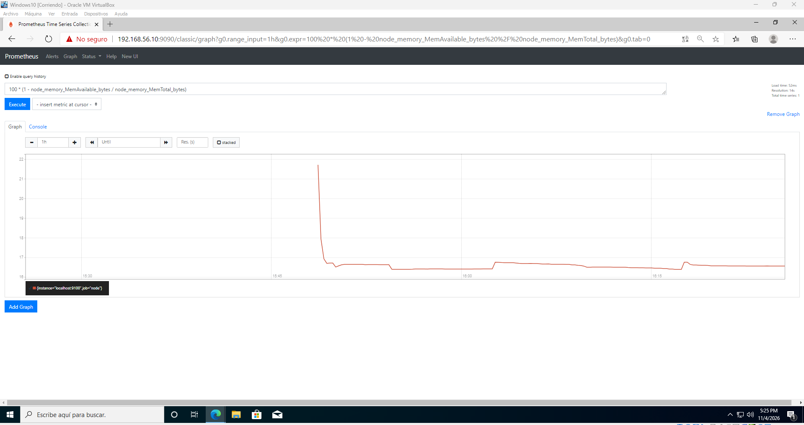

*Figura — Gráfica inicial del porcentaje de RAM.*

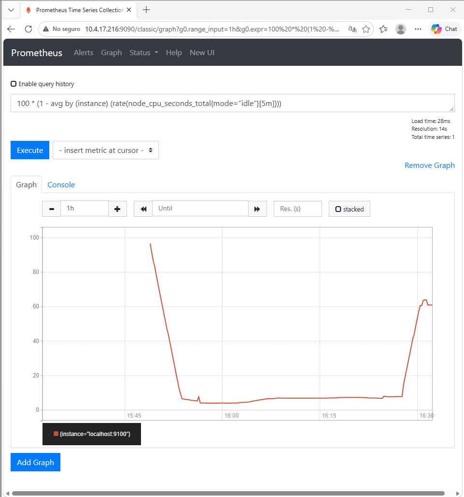

*Figura — Gráfica inicial del porcentaje de CPU.*

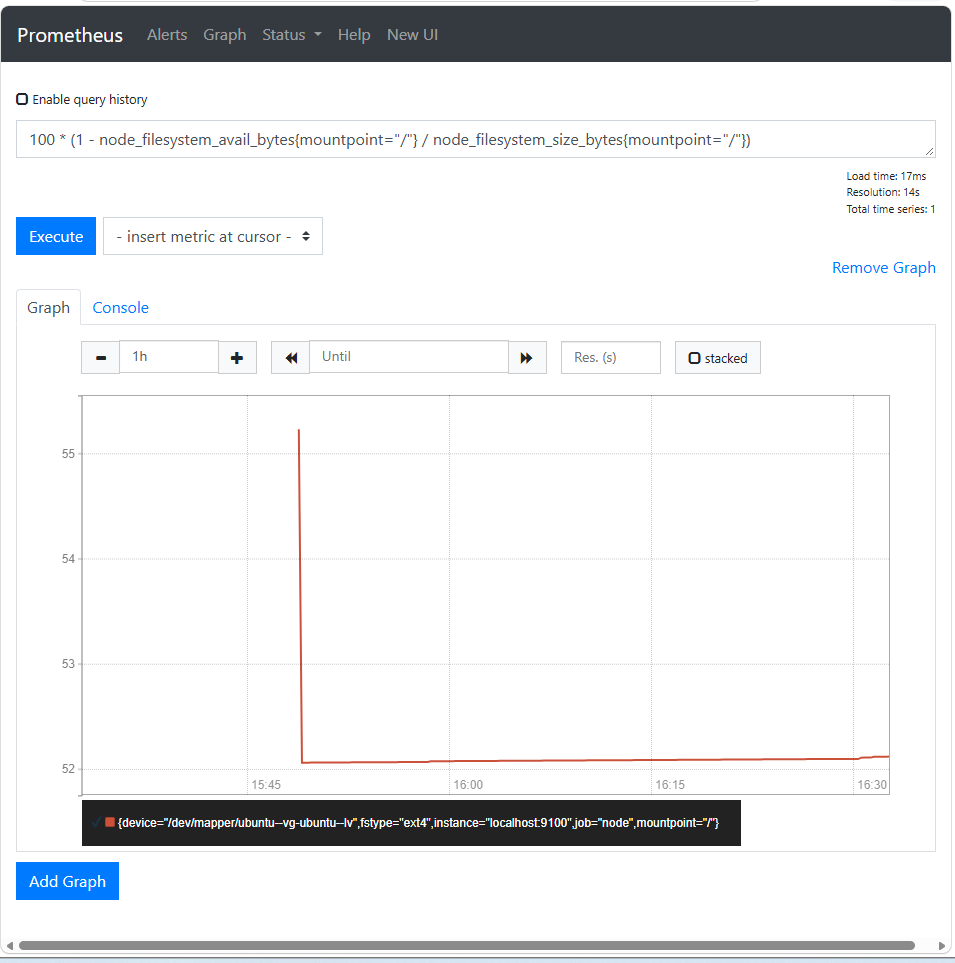

*Figura — Gráfica inicial de ocupación del sistema de archivos raíz.*

---

## 8. Sincronización de los relojes: incidencia durante la puesta en marcha

Al abrir Prometheus desde Windows apareció una advertencia de diferencia horaria entre navegador y servidor. El problema no era la ausencia de métricas, sino que las marcas de tiempo podían no coincidir con la hora de consulta.

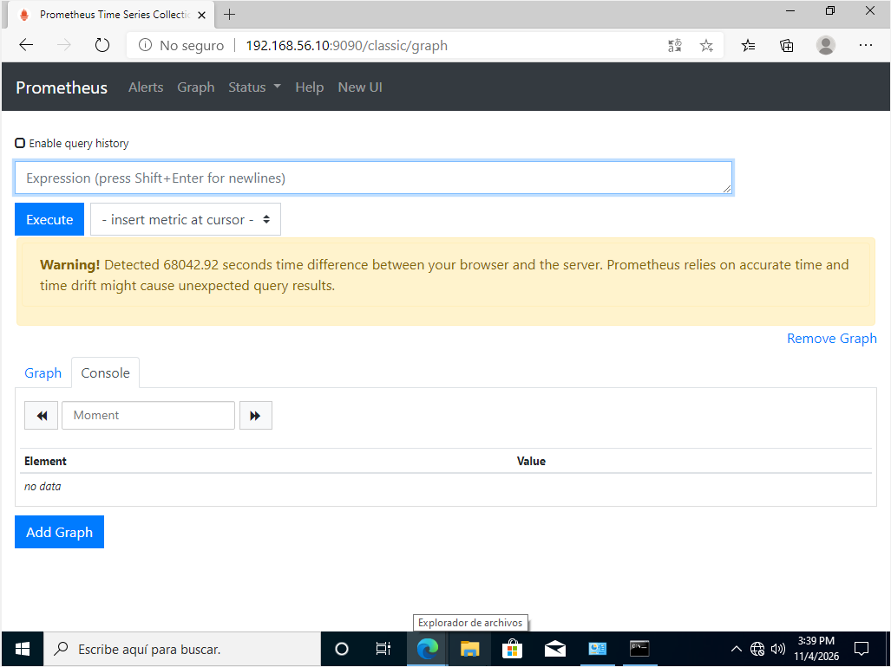

*Figura — Advertencia por desfase entre el navegador Windows y Prometheus.*

Se investigó con `timedatectl status`, `chronyc tracking` y `date -u`. En algunos momentos Chrony declaró un desfase grande; se aplicó una corrección inmediata con:

```bash
sudo chronyc makestep
chronyc tracking
date -u
```

En Windows se diagnosticó por separado el servicio W32Time, que inicialmente mostraba `Local CMOS Clock` y ausencia de sincronización NTP válida. Se revisó su fuente horaria y se consiguió que desapareciera la advertencia del navegador. **La causa de los desfases recurrentes al reanudar VMs no quedó aislada definitivamente**; la guía no presenta `makestep` como solución permanente.

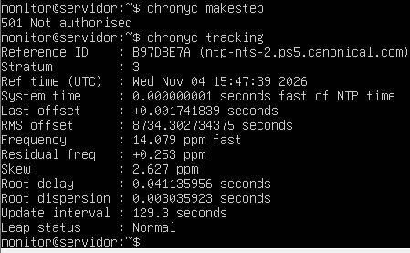

*Figura — Chrony mostrando un desfase de tiempo casi nulo tras makestep.*

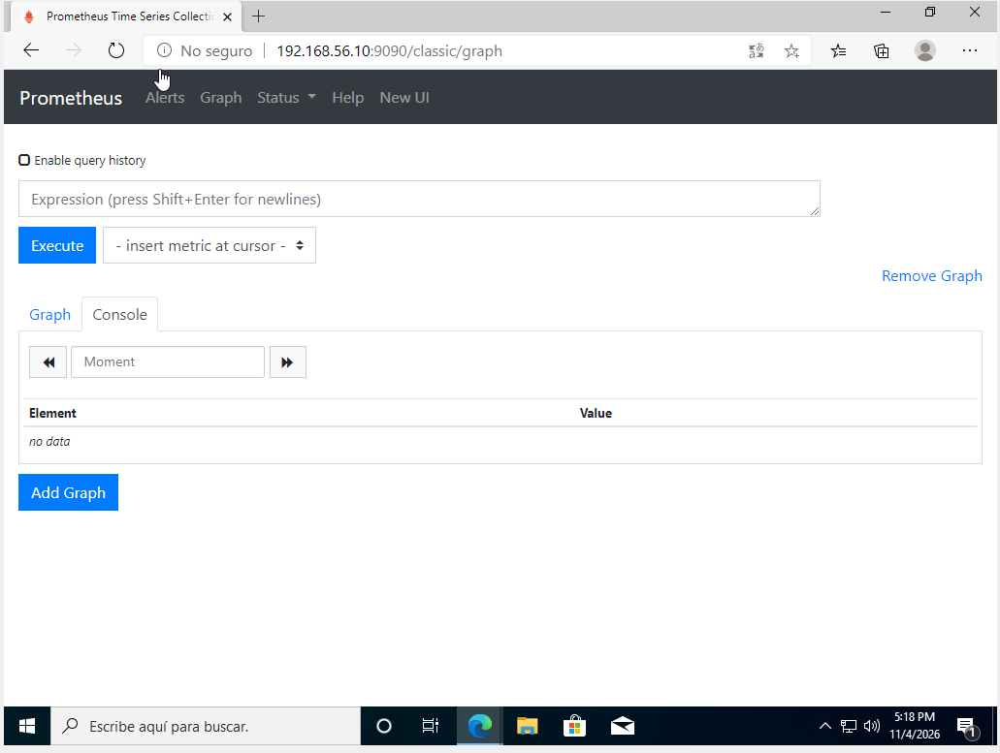

*Figura — Prometheus vuelve a abrir sin advertencia horaria.*

**Lección aprendida:** monitorización y tiempo están relacionados. Si las VMs se suspenden, reanudan o cambian de hora de manera brusca, verificar NTP antes de interpretar gráficas `No data`. La supervisión continua de relojes se considera una mejora pendiente.

---

## 9. Grafana y dashboard

Grafana se instaló en `monitor01` desde el repositorio oficial, una vez confirmado que había memoria y espacio disponibles y el puerto 3000 estaba libre.

```bash
sudo apt install wget gnupg ca-certificates
sudo mkdir -p /etc/apt/keyrings
sudo wget -O /etc/apt/keyrings/grafana.asc https://apt.grafana.com/gpg-full.key
sudo chmod 644 /etc/apt/keyrings/grafana.asc
echo "deb [signed-by=/etc/apt/keyrings/grafana.asc] https://apt.grafana.com stable main" | sudo tee /etc/apt/sources.list.d/grafana.list
sudo apt update
sudo apt install grafana
sudo systemctl enable --now grafana-server
systemctl is-active grafana-server
sudo ss -lntp | grep ':3000 '
```

El acceso desde Windows se hizo por `http://192.168.56.10:3000`. En Grafana se cambiaron las credenciales iniciales y se añadió la fuente de datos de tipo Prometheus con URL `http://localhost:9090` (localhost hace referencia al servidor **Grafana**, que comparte la VM con Prometheus).

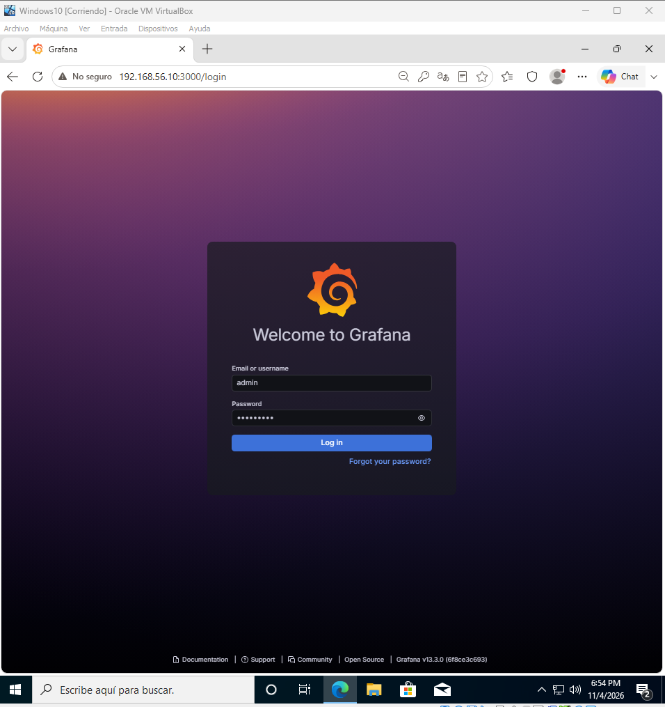

*Figura — Pantalla de acceso de Grafana desde Windows.*

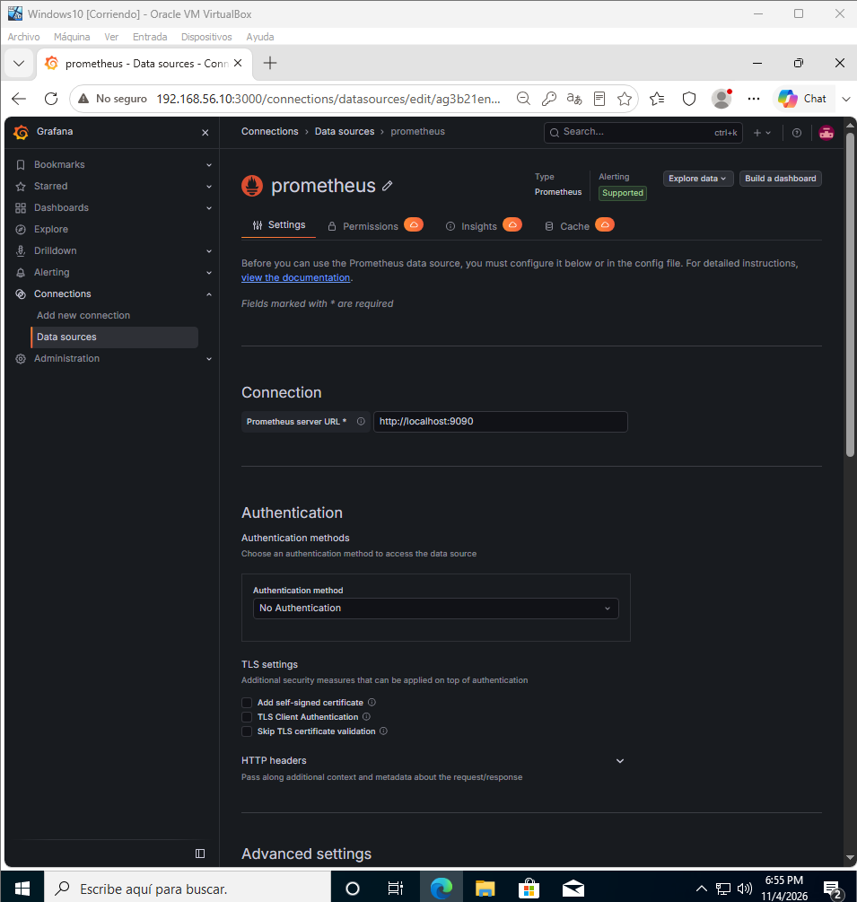

*Figura — Fuente de datos Prometheus configurada en Grafana.*

### Construcción del dashboard desde cero

El dashboard se llamó **ASIR | Infrastructure Monitoring**. No se importó una plantilla de terceros: se creó el panel de disponibilidad y luego se añadieron CPU, RAM y disco. En el editor de Grafana se utilizó modo **Code** para escribir PromQL.

| Panel | Visualización | Consulta / idea |
|---|---|---|
| Server Availability | Stat (Instant) | `up{job="node"}`; 1 = UP, 0 = DOWN |
| CPU Usage (%) | Time series (Range) | `rate(node_cpu_seconds_total{mode="idle"}[5m])` |
| Memory Usage (%) | Time series (Range) | `MemAvailable / MemTotal` |
| Disk Usage (%) | Gauge (Instant) | `avail / size` en `mountpoint="/"` |

Las consultas completas están en [consultas-promql.md](../queries/consultas-promql.md). Un error habitual fue escribir `environment="lab"` en una consulta que en ese momento no devolvía series: se comprobó primero `up` sin filtros y después se verificaron las etiquetas. También se ajustó la diferencia entre **Instant** (último valor) y **Range** (serie temporal).

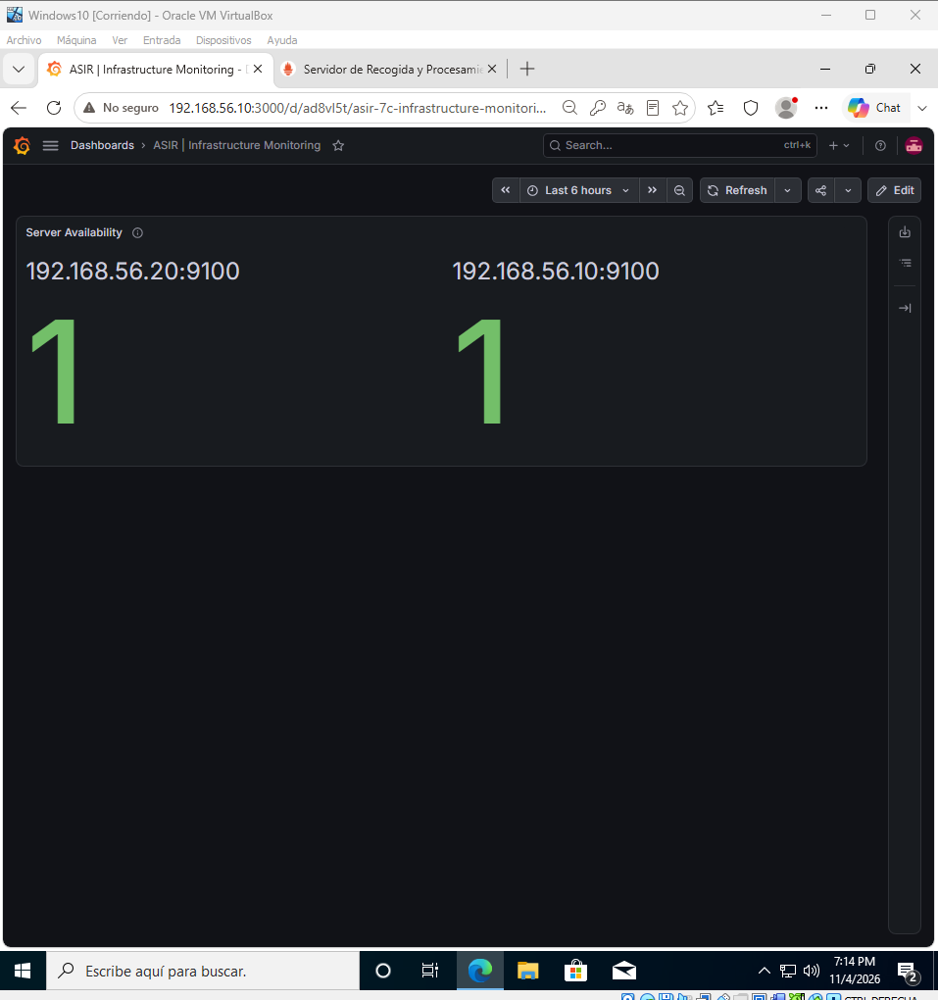

*Figura — Primer panel Stat de disponibilidad de dos servidores.*

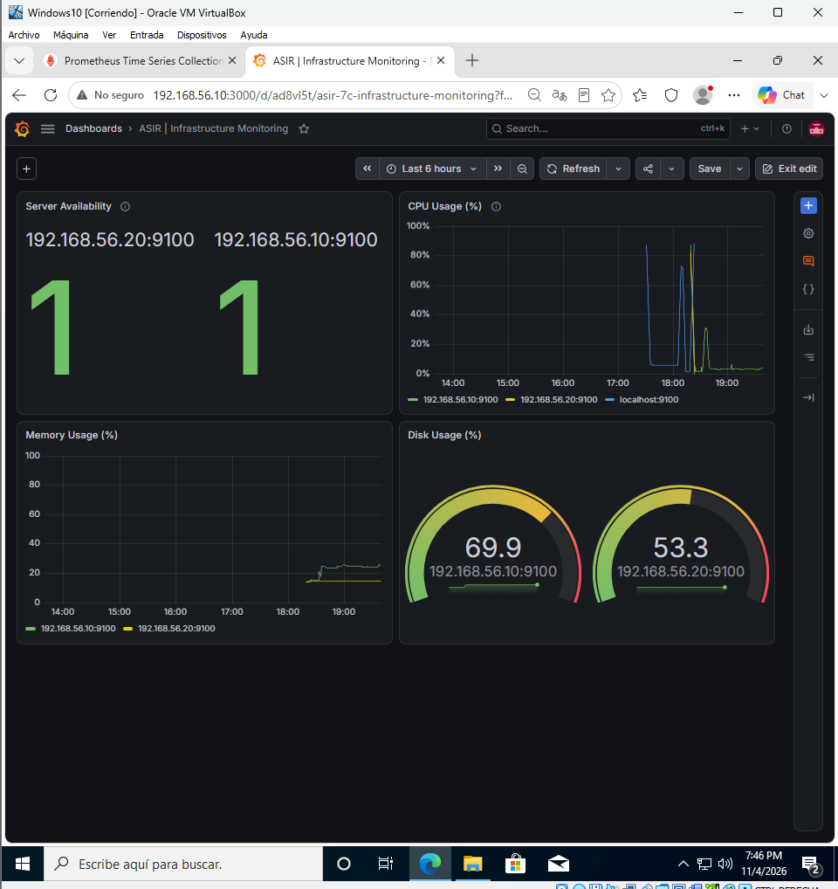

*Figura — Dashboard con disponibilidad, CPU, RAM y disco.*

**Interpretación:** que una métrica tenga una gráfica plana no es fallo: memoria y disco cambian más lentamente que CPU. Los porcentajes observados en capturas son mediciones de un momento, no requisitos de rendimiento. El gauge de disco refleja espacio no disponible, que no equivale siempre a la salida exacta de `df`.

---

## 10. Pruebas reales de monitorización

### 10.1. Carga controlada de CPU

Primero se probó `stress-ng` en `servidor01`; los trabajadores fallaron con `SIGILL`, por lo que **no se declaró esa ejecución como satisfactoria**. Se eligió una carga alternativa limitada a un proceso de CPU, descartando su salida hacia `/dev/null` para no llenar disco:

```bash
# Ejecutar solamente en servidor01
 yes > /dev/null &
PID=$!
echo "Proceso de carga: $PID"
sleep 120
kill "$PID"
wait "$PID" 2>/dev/null
echo "Prueba finalizada"
```

La medición en Grafana se hizo con intervalos cortos (por ejemplo, los últimos 15 minutos) y una consulta de tasa, que suaviza las variaciones según la ventana seleccionada. En la captura disponible se ve un aumento marcado de CPU para `192.168.56.20:9100`, seguido de descenso; esto respalda que el sistema detecta cambios de carga.

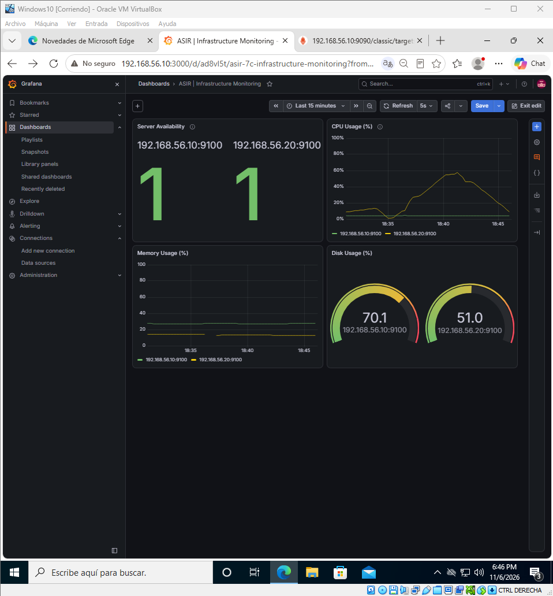

*Figura — Aumento y descenso de CPU en servidor01 observado en Grafana.*

### 10.2. Caída y recuperación de un agente

Se simuló una indisponibilidad de Node Exporter en `servidor01` sin apagar la VM:

```bash
sudo systemctl stop prometheus-node-exporter
systemctl is-active prometheus-node-exporter
# En Prometheus el target 192.168.56.20:9100 pasa a DOWN.
sudo systemctl start prometheus-node-exporter
systemctl is-active prometheus-node-exporter
```

Al detener el agente, Prometheus no pudo conectarse al puerto 9100 y registró `connection refused`. Después de iniciarlo, el target volvió a **UP**. La consulta que se utilizó para estudiar el histórico en Grafana Explore fue:

```promql
up{job="node",instance="192.168.56.20:9100"}
```

En modo **Range** se observa la transición **1 → 0 → 1** (en la evidencia aparecen dos intervalos DOWN). Esto **no prueba que se haya apagado el servidor**, sino que el endpoint del exporter quedó inaccesible.

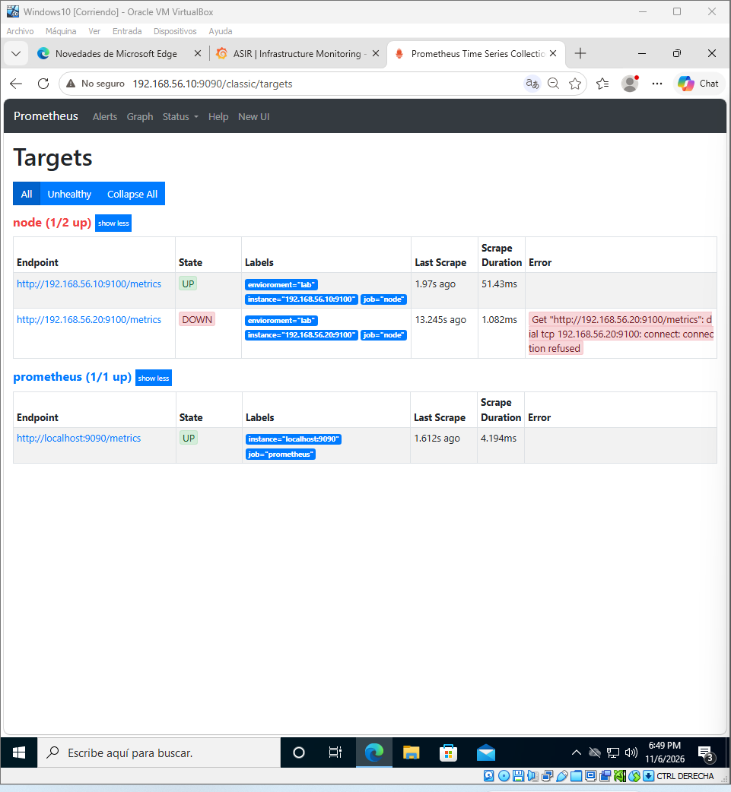

*Figura — Evidencia de la fase de recuperación del exporter.*

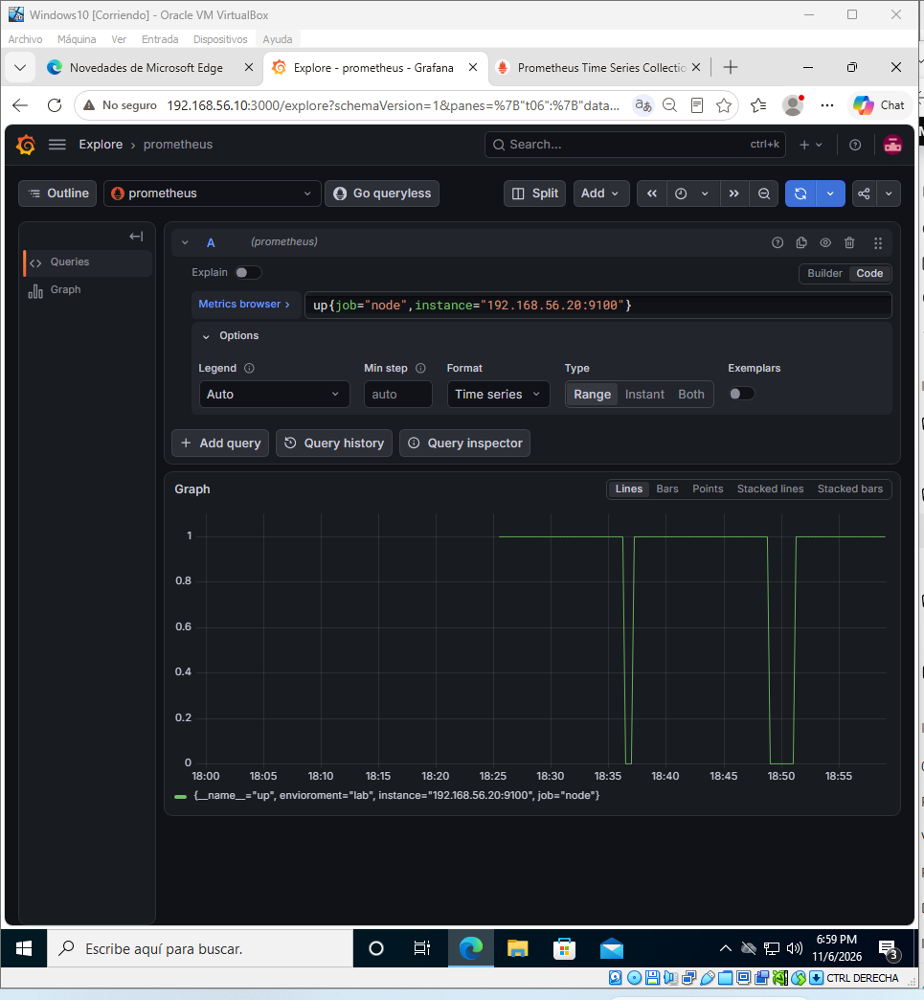

*Figura — Histórico de caídas y recuperaciones en Grafana Explore.*

---

## 11. Incidencias y soluciones

Estas incidencias forman parte del aprendizaje. Se presentan como problemas observados, con diagnóstico y grado de resolución, sin atribuir causas que no se pudieron demostrar.

| Incidencia | Síntoma | Qué se hizo | Situación |
|---|---|---|---|
| Hora desajustada | Prometheus avisaba de grandes diferencias horarias y Grafana mostraba series ausentes | `chronyc tracking`, `sudo chronyc makestep`, revisión de Windows Time y NTP | Recuperado varias veces; **persistencia tras reanudar VM pendiente** |
| `No data` en Grafana | Paneles en blanco aunque el servicio estaba activo | Pruebas con `up`, API Prometheus, corrección de filtros de etiquetas, tipos Range/Instant y revisión de tiempo | Dashboard recuperado |
| `stress-ng` con `SIGILL` | Trabajadores fallaban al iniciar la carga | Se evitó repetir la prueba fallida y se utilizó `yes` | Carga alternativa funcional; causa exacta de SIGILL pendiente |
| Consulta API sin expresión | `bad_data` / `no expression found` | Se añadió `?query=up` o `--data-urlencode` correctamente | Resuelto |
| Consultas PromQL ejecutadas en Bash | `syntax error near unexpected token '('` | Ejecutar PromQL en Grafana/Prometheus, no en la shell | Resuelto |
| URL `/targets` sin UI moderna | Página informativa de paquete Ubuntu | Usar `/classic/targets` | Resuelto |
| Visualización tras parar exporter | `connection refused` | Recuperar servicio con systemd | Resuelto / prueba documentada |

**Lecciones técnicas:** diferenciar fallo de red de un bloqueo ICMP; utilizar `curl` para comprobar endpoints reales; distinguir el puerto local de cada máquina; confirmar filtros de etiquetas; verificar primero los relojes al trabajar con series temporales.

---

## 12. Conclusiones y cómo reproducirlo

El laboratorio consiguió monitorizar dos servidores Ubuntu con un Prometheus central y un dashboard Grafana de cuatro paneles. Se documentó la conectividad interna, se consultaron métricas mediante HTTP y PromQL, se generó una carga medible y se simuló la caída/recuperación de un agente.

### Resumen operativo para una nueva instalación

1. Crear `monitor01`, `servidor01` y una VM Windows cliente dentro de VirtualBox.
2. Configurar los tres adaptadores de la red interna `asir-monitoring` y las direcciones `192.168.56.10`, `.20` y `.100`.
3. Instalar Node Exporter en ambos Ubuntu y verificar `/metrics` en el puerto 9100.
4. Instalar Prometheus en `monitor01`, declarar los targets, validar YAML y verificar `/classic/targets`.
5. Instalar Grafana en `monitor01`, agregar Prometheus con URL `http://localhost:9090` y crear los cuatro paneles.
6. Comprobar sincronización horaria; ejecutar y documentar pruebas de CPU y disponibilidad.

### Archivos reproducibles y tareas pendientes

- [`configs/prometheus/prometheus.example.yml`](../configs/prometheus/prometheus.example.yml): **ejemplo reconstruido**; falta extraer la configuración final real de `monitor01`.
- [`queries/consultas-promql.md`](../queries/consultas-promql.md): expresiones de las visualizaciones.
- `dashboards/infrastructure-monitoring.json`: **pendiente de exportar desde Grafana**, no debe inventarse.
- La causa raíz del salto de reloj tras suspender/reanudar VMs requiere una comprobación persistente antes de afirmar que el entorno está totalmente estabilizado.

> **Seguridad y límites:** laboratorio educativo aislado. Grafana y Prometheus se utilizaron sobre HTTP; no publicar estas interfaces en Internet sin TLS, autenticación, firewall y controles adecuados. No subir contraseñas, tokens ni otros secretos al repositorio.
